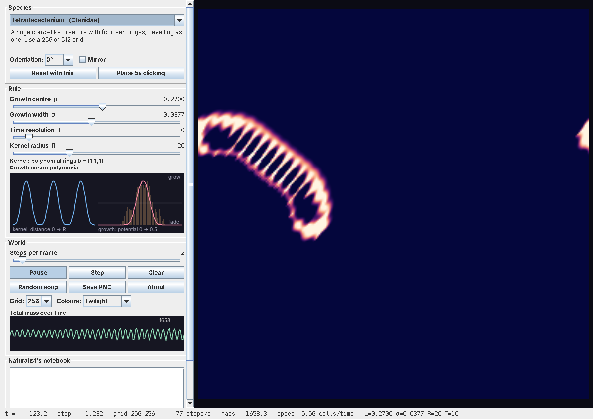
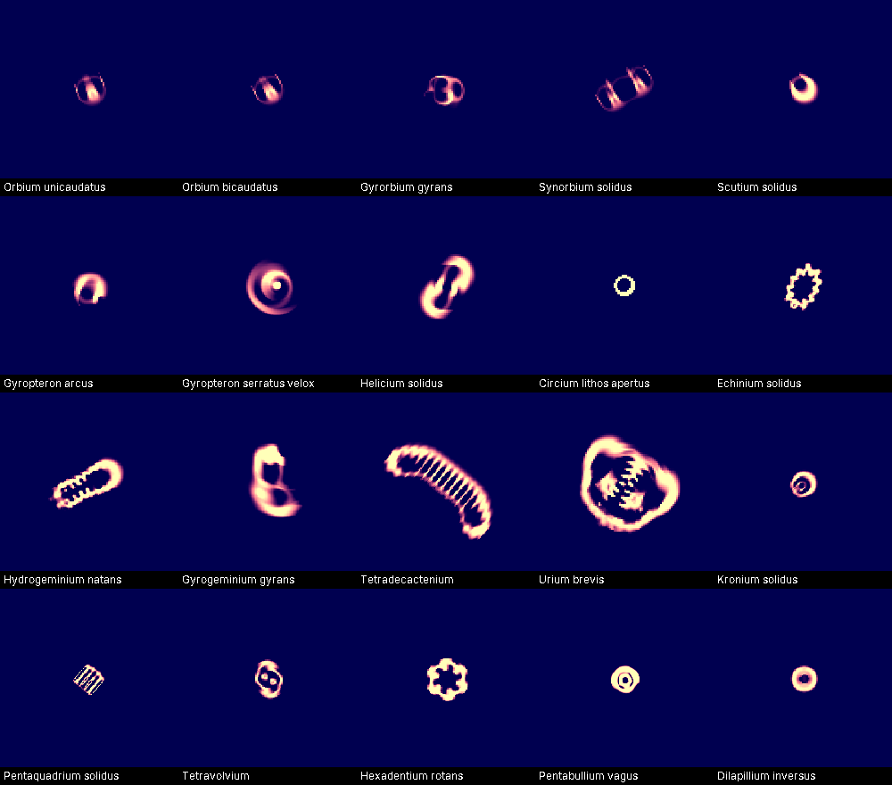
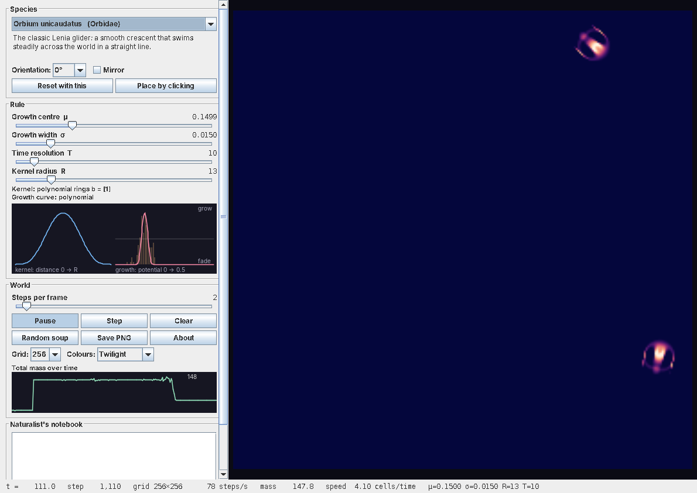
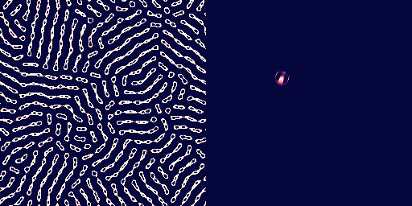

# Lenia Lab

**A naturalist's guide to Lenia: smooth, self-organising artificial creatures that glide, spin and heal.**



Lenia is a world of artificial life created by **[Bert Wang-Chak Chan](https://chakazul.github.io/lenia.html)**. It's Conway's famous Game of Life with everything made smooth, and what lives in it looks remarkably like microscopic organisms seen down a microscope. There are gliders that swim in straight lines, twins that travel together, combs, rings, spinners and creatures that repair themselves when cut.

Chan studied these creatures the way a naturalist studies wildlife. He catalogued more than 400 species in 18 families, gave them Latin-style names, and described their anatomy and behaviour in his paper [*Lenia — Biology of Artificial Life*](https://arxiv.org/abs/1812.05433) (*Complex Systems*, 2019).

**Lenia Lab** is a desktop app for exploring his world. It contains 20 of Chan's species, lets you change the rules while they live, and includes a notebook for recording any new creatures you find. All the credit for Lenia and its creatures belongs to Bert Chan. This lab is simply a new window onto his work.

You don't need to know any programming or mathematics. Pick a species and watch.

---

## Getting started

Lenia Lab is a single file. It needs **Java 17 or newer** and nothing else.

1. **Check whether you already have Java.** Open Terminal (on a Mac) or Command Prompt (on Windows) and type:

   ```
   java -version
   ```

   If it reports version 17 or higher, skip to step 3.

2. **Install Java if needed.** A free, trustworthy build is available from [Adoptium](https://adoptium.net). Download the installer for your computer and run it.

3. **Download** `LeniaLab.java` from this repository.

4. **Run it.** In Terminal, go to the folder where you saved the file and type:

   ```
   java LeniaLab.java
   ```

The window opens with *Orbium*, the classic Lenia glider, swimming across the world.

---

## How Lenia works

In the Game of Life, every cell is either alive or dead, each cell looks only at its eight immediate neighbours, and time ticks forward in whole steps. Lenia makes all three smooth:

- Each cell holds a value **anywhere between 0 and 1**, not just on or off.
- Each cell senses a **soft ring** of neighbours, several cells wide, instead of just the eight touching it. This ring is called the **kernel**, and its size is the **kernel radius R**.
- Time flows in **small steps**. **T** sets how finely time is sliced.

Each step, every cell takes a weighted average of its surroundings using the ring. That average goes through a bell-shaped **growth curve**. If the average is close to a sweet spot, **μ** (within a width of roughly **σ**), the cell grows a little. If it's too crowded or too empty, the cell fades. That's the whole rule.

With the right values of μ, σ, R and T, patterns appear that hold their shape and move about on their own. Chan calls them life forms.

---

## The gallery



The lab includes 20 species from Chan's catalogue, at least one from each major family. Every one was checked to survive in this lab. Choose one from the **Species** menu and it appears in the middle of the world:

| Species | Family | What it does |
|---|---|---|
| *Orbium unicaudatus* | Orbidae | The classic glider: a smooth crescent that swims in a straight line. |
| *Orbium bicaudatus* | Orbidae | A two-tailed cousin of Orbium. |
| *Gyrorbium gyrans* | Orbidae | An Orbium relative whose name means "gyrating". |
| *Synorbium solidus* | Orbidae | Several Orbium-like units fused into one larger glider. |
| *Scutium solidus* | Scutidae | A shield-shaped creature that drifts at half Orbium's speed. |
| *Gyropteron arcus* | Pterifera | A winged glider from the largest family in the catalogue. |
| *Gyropteron serratus velox* | Pterifera | A fast, saw-edged winged glider. |
| *Helicium solidus* | Helicidae | A large, twisted creature that churns almost in place. |
| *Circium lithos apertus* | Circidae | A still ring. Not every creature moves. |
| *Echinium solidus* | Echinidae | A spiny, urchin-like creature that creeps slowly. |
| *Hydrogeminium natans* | Geminidae | A "swimming twin" with a striped interior. |
| *Gyrogeminium gyrans* | Geminidae | A rotating twin that sweeps across the world. |
| *Tetradecactenium* | Ctenidae | A huge comb with fourteen ridges, travelling as one. |
| *Urium brevis* | Uridae | A large creature with complex internal structure. |
| *Kronium solidus* | Kronidae | A crown-shaped creature with an inner ring. |
| *Pentaquadrium solidus* | Quadridae | A striped, square-ish creature with a very large kernel. |
| *Tetravolvium* | Volvidae | A small four-lobed creature that stays in place. |
| *Hexadentium rotans* | Dentidae | A six-toothed ring that turns in place. |
| *Pentabullium vagus* | Bullidae | A bubble with nested rings that wanders slowly. |
| *Dilapillium inversus* | Lapillidae | A small doughnut-shaped "pebble" that sits almost still. |

Use **Orientation** and **Mirror** to turn a creature before it's placed. Press **Place by clicking** to add more of the same species wherever you click.



*Four Orbiums were placed on collision courses. Two met and destroyed each other, which is why the mass graph at the bottom left drops by half.*

---

## Things to try

- **Wound a creature.** Right-drag across part of an Orbium to cut it. A small cut usually heals and the creature glides on. A cut through the middle is usually fatal. Somewhere in between is the point of no return.
- **Push the rules.** While a creature moves, nudge **μ** or **σ** slightly. Many species survive only in a narrow band of values. Watch the bars on the growth plot: they show where the creature's cells currently sit on the growth curve. If they slide off the edge of the bell, the creature dies.
- **Stage a collision.** Place two gliders heading towards each other and see what happens.
- **Go fishing.** Choose Orbium and press **Random soup**. Like Chan's own software, this scatters a few dozen small patches of random values. Then wait. In testing, three things happened. Sometimes every patch faded away. Sometimes the world filled with a writhing tangle of worms. And sometimes a single Orbium formed out of the noise and swam away, a creature assembled from nothing but random numbers and the rule. Keep pressing Random soup until you catch one.

  
- **Change the speed of time.** **T** sets how finely time is sliced. Raising it makes motion smoother. Lowering it too far can make creatures fall apart, because each step becomes too coarse.

---

## The naturalist's notebook

- **Record** saves the creature currently in the world, together with its rule, size, mass and speed. Clear away everything else first, so the notebook captures just one creature.
- Click any entry to bring it back.
- **Export…** saves the notebook as a file in **Chan's own format**, so your specimens can also be opened in his software.
- **Import…** loads a notebook, or **Chan's complete catalogue**. Download [`animals.json`](https://github.com/Chakazul/Lenia/blob/master/Python/animals.json) from his repository and import it to add all his two-dimensional species to your notebook. Some need a larger grid, and not all will survive at every grid size.

---

## The controls

| Control | What it does |
|---|---|
| **Species** | Choose a species and reset the world with it. |
| **Orientation / Mirror** | Rotate or mirror the creature before it's placed. |
| **Reset with this** | Clear the world and place the chosen species in the middle. |
| **Place by clicking** | Click in the world to add more of the chosen species. |
| **Growth centre μ** | The sweet-spot density at which cells grow. |
| **Growth width σ** | How tolerant the growth curve is. Smaller means pickier. |
| **Time resolution T** | How many steps make up one unit of time. |
| **Kernel radius R** | The size of the ring each cell senses. |
| **Steps per frame** | How many steps are calculated between screen updates. |
| **Play / Pause, Step, Clear** | Control time, or empty the world. |
| **Random soup** | Scatter random patches of life across the world. |
| **Grid** | 128, 256 or 512 cells across. The world wraps around at the edges. |
| **Colours** | Twilight, Microscope, Ember or Ink. |
| **Save PNG** | Save a picture of the world. |

The two small plots show the **kernel**, which is the ring's profile from the centre out to distance R, and the **growth curve**. The kernel's peaks are the distances a cell pays most attention to. Below them, the **total mass** graph shows whether a creature is stable, growing, shrinking or pulsing.

**Using the mouse:** left-drag adds life; right-drag cuts and erases.

---

## How faithful is it?

The lab follows Chan's own Python implementation of Lenia: the same kernel shapes, the same growth curves, the same update rule and the same file format. Every one of the 20 gallery species was tested and survives. In a wider test, 440 of the first 456 species in his catalogue survived. A world has a single rule, so only species that share the same parameters can live together. Chan's later *extended* Lenia, with several channels and kernels, isn't included.

The calculation uses a fast Fourier transform, runs on all your computer's processor cores, and is written in plain Java with no extra libraries.

---

## Credits

**Lenia and all its species** were created by **Bert Wang-Chak Chan**.

- His Lenia portal: <https://chakazul.github.io/lenia.html>
- His code and species catalogue: <https://github.com/Chakazul/Lenia> (MIT licence)
- Run Lenia in your browser: <https://chakazul.github.io/Lenia/JavaScript/Lenia.html>
- B. W.-C. Chan, "Lenia: Biology of Artificial Life", *Complex Systems* 28(3), 251–286 (2019): [arXiv:1812.05433](https://arxiv.org/abs/1812.05433), [journal version](https://doi.org/10.25088/ComplexSystems.28.3.251)
- B. W.-C. Chan, "Lenia and Expanded Universe", *ALIFE 2020*: [arXiv:2005.03742](https://arxiv.org/abs/2005.03742)

The gallery species are taken from Chan's catalogue, `animals.json`, under the MIT licence (Copyright © 2018 Bert Chan).

**Lenia Lab**
Architect: Mario Gianota
Implementation: Claude (Anthropic)

Released under the MIT licence.

If you enjoy this, try the companion labs: **Primordial Soup Lab** (self-replicating code), **Gray–Scott Lab** (chemical cells that divide) and **Swift–Hohenberg Lab** (fingerprints and sand ripples).
